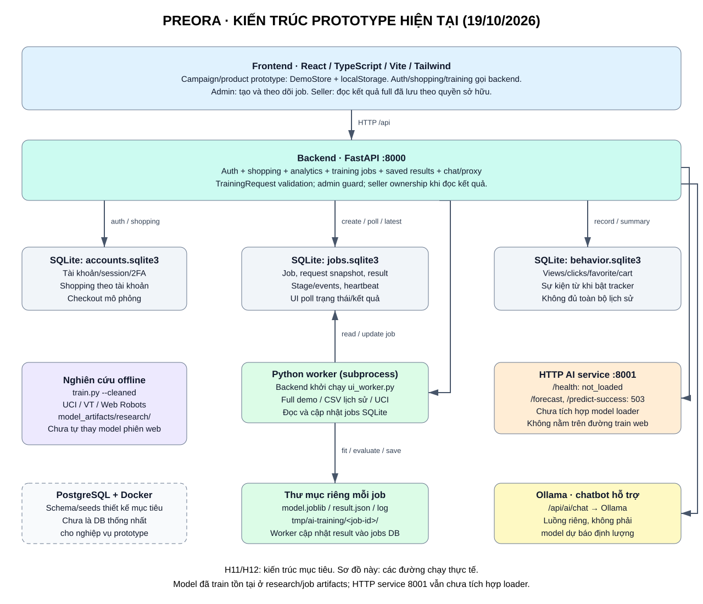

# PREORA — Kiến trúc prototype và thiết kế mục tiêu

Đối chiếu code ngày 19/10/2026. Phạm vi báo cáo: **Design – Data preparation – Technologies**. Phân biệt phần đang chạy, mô phỏng và thiết kế mục tiêu; việc có artifact ML không đồng nghĩa mọi endpoint đã phục vụ artifact đó.

## Sơ đồ hiện trạng

Bản chỉnh sửa được: [draw.io](diagrams/PREORA_CURRENT_ARCHITECTURE.drawio). Sơ đồ này bổ sung cho H11/H12 (thiết kế mục tiêu), không thay đổi bộ sơ đồ gốc do người dùng cung cấp.

## Thành phần và persistence thực tế

| Thành phần | Hiện trạng | Lưu trữ / giới hạn |
|---|---|---|
| React + TypeScript + Vite + Tailwind | Giao diện khách hàng, seller, admin và partner prototype | `DemoStore` lưu localStorage: sản phẩm, chiến dịch, vòng đời và nhiều dữ liệu demo; có gọi API auth/shopping/AI |
| Backend FastAPI + Pydantic, cổng 8000 | Auth/session, 2FA, shopping, analytics, chat gateway, training jobs, đọc kết quả AI theo ownership | Không chỉ là health/proxy skeleton |
| Auth và shopping theo tài khoản | Giỏ hàng, yêu thích, voucher, đơn/biên nhận checkout mô phỏng được lưu phía server | SQLite `backend/data/accounts.sqlite3` mặc định (`AUTH_DATABASE_PATH`); catalogue server là JSON; checkout không thu tiền thật |
| Theo dõi hành vi | Views/clicks từ frontend; favorite/cart từ mutation shopping thành công | SQLite `tmp/ai-training/behavior.sqlite3`; chỉ quan sát từ khi bật tracker, không đủ toàn bộ lịch sử; số sự kiện không phải số người duy nhất |
| Huấn luyện trên web | Backend tạo job và chạy Python worker bằng subprocess | `tmp/ai-training/jobs.sqlite3`, thư mục mỗi job có model, kết quả và log; cấu hình qua `TRAINING_JOBS_DIR` |
| Mô hình nghiên cứu offline | UCI, Virginia Tech và Web Robots đã có pipeline và artifact | `ai-service/model_artifacts/research/`; không tự thay model từng phiên web |
| HTTP AI service cổng 8001 | Endpoint inference dự phòng chưa tích hợp model | `/health`: `model_status=not_loaded`; `/forecast`, `/predict-success` trả 503; không nằm trên đường train web |
| Chatbot Ollama | Backend gọi Ollama cho hỏi đáp | Luồng độc lập với forecasting/classifier; không dùng LLM để tạo số liệu thay mô hình ML |
| PostgreSQL qua Docker Compose | Có schema/seeds phục vụ thiết kế và phát triển | Chưa là persistence thống nhất cho nghiệp vụ prototype; có `DATABASE_URL` không chứng minh mọi module đã dùng PostgreSQL |

## Bốn đường chạy AI

### 1. Huấn luyện và dự báo trên web — đang chạy

`Admin UI → POST /api/admin/ai-training → TrainingRequest validation → jobs.sqlite3 → subprocess ui_worker.py → model + result + log theo job`.

- `campaign_demo`: `full_campaign.py` tạo lịch sử mô phỏng, fit regressor + classifier; kết quả có nhãn DEMO.
- `campaign_history`: cùng pipeline full nhưng đọc CSV do admin cung cấp và xác nhận. Hệ thống kiểm tra schema/nhãn/thời gian, không độc lập xác minh nguồn gốc.
- `retail`: thực nghiệm chuyển giao bán lẻ UCI, dự báo 7 ngày và ngoại suy; không phải model final demand PREORA đầy đủ.
- UI poll `GET /api/admin/ai-training/{id}`. Không gọi HTTP 8001 để train.
- Snapshot được chọn có thể có từ 1 ngày quan sát; đến 28 ngày gần nhất. Ngày không quan sát không được tự nhận là doanh số 0; mẫu textarea cần được người vận hành kiểm tra.

### 2. Seller xem kết quả full đã lưu — đang chạy

`Seller UI → GET /api/ai/campaigns/{id}/latest → kiểm tra admin hoặc seller sở hữu → latest successful full job → result`.

Đây là **đọc kết quả đã tính**, không thực hiện inference mới mỗi lần mở trang. Snapshot cũ phải được nhận diện; chưa có kết quả full trả 404. Các luồng cũ dùng `demoForecastApi` vẫn là công thức demo, không được gọi là kết quả trained ML.

### 3. HTTP inference độc lập — chưa tích hợp

`POST /api/ai/forecast hoặc /predict-success → HTTP AI service :8001 → 503`.

Backend forward lỗi 503, không tự chuyển sang công thức demo để giả làm model thật. Cần thêm hợp đồng feature/model loader riêng trước khi coi đây là đường triển khai production. Artifact nghiên cứu có target/feature khác nhau, không thể load thay thế tùy ý vào API PREORA.

### 4. Train nghiên cứu offline và chatbot

- Offline: `train.py --dataset all --cleaned → data/processed → research artifacts + training/reports`.
- Chat: `/api/ai/chat → Ollama`. Ngữ cảnh prototype không được coi là dữ liệu giao dịch đã xác minh; chatbot chỉ hỗ trợ hỏi đáp.

## Công nghệ và lý do chọn trong prototype

| Công nghệ | Vai trò / lý do | Giới hạn hiện tại |
|---|---|---|
| React, TypeScript, Vite, Tailwind | UI theo vai trò, kiểm tra kiểu, dev/build và styling | Không thay việc kiểm tra quyền phía server |
| Python, FastAPI, Pydantic | API và kiểm tra input; dùng chung hệ sinh thái Python với ML | Worker subprocess là cơ chế local, chưa phải hàng đợi phân tán |
| pandas, NumPy, openpyxl | CSV/XLSX, thống kê, tạo mẫu theo thời gian | Web Robots lớn được làm sạch theo chunk + SQLite |
| scikit-learn, joblib | Pipeline tabular, HistGradientBoosting regression/classification, lưu preprocessing cùng model | Cần đánh giá riêng mỗi nguồn/target; chỉ load artifact tin cậy |
| SQLite, localStorage | Persistence nhẹ cho prototype, job và telemetry | Không mô tả là kiến trúc dữ liệu production thống nhất |
| PostgreSQL, Docker Compose | Schema quan hệ mục tiêu và môi trường local | Chưa chuyển toàn bộ module nghiệp vụ sang PostgreSQL |
| Ollama | Hỏi đáp local, tách khỏi dự báo định lượng | Không chứng minh chất lượng demand forecasting |

## Thiết kế mục tiêu và ranh giới triển khai

H11/H12 mô tả mục tiêu: client theo vai trò → backend nghiệp vụ → persistence quan hệ + pipeline dữ liệu → model serving/versioning. Payment/notification bên ngoài, monitoring theo kết quả thật và retraining có phê duyệt là các phần cần tích hợp/kiểm chứng tiếp, không được ghi là đã vận hành đầy đủ.

Các module trong sơ đồ là trách nhiệm logic; chưa khẳng định là microservices triển khai độc lập. Các portal hiện dùng chung frontend. Các vai trò Business Admin, AI/Data Operator và IT Admin hiện gộp vào quyền `admin` trong prototype.

## Tài liệu liên quan

- [Ánh xạ nguồn dữ liệu và 16 feature](DATA_PROVENANCE.md)
- [Vai trò thiết kế và quyền thực thi](ROLE_MAPPING.md)
- [API hiện tại và thiết kế](API_CONTRACT.md)
- [Huấn luyện trên web](HUAN_LUYEN_AI_TREN_WEB.md)
- [Làm sạch dữ liệu](LAM_SACH_DU_LIEU_AI.md)
